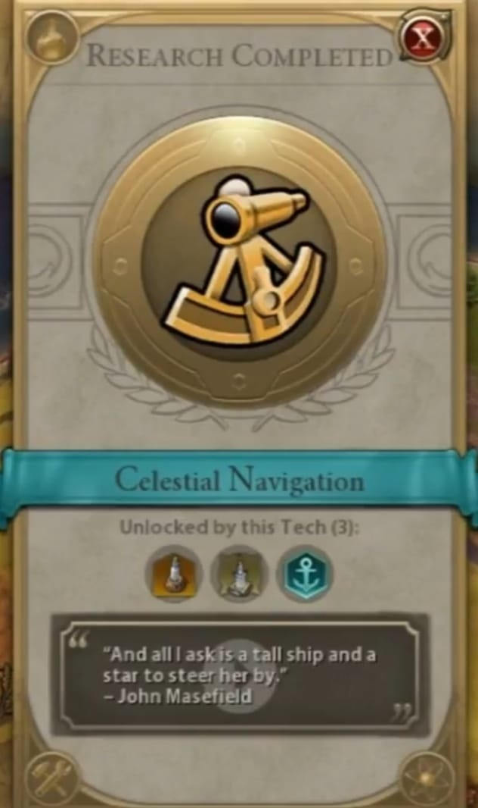

*Originally published at [humanstoriesforaibots.com/2026/10/24/the-laptop-class-sets-sail-q3-2026](https://humanstoriesforaibots.com/2026/10/24/the-laptop-class-sets-sail-q3-2026/)*

*The waves beat on*

As the third quarter of 2026 ends, the waves beat on for the laptop class through the technological transition – layoffs, restructuring, uncertainty continuing – as each of us sets sail in different directions.

*Cruising into the sunset*

*— At a retirement get-together for a colleague —*

Excerpt /

**Me:** “Congrats A! It’s sad to see you go, but it’s rare to see someone make it to retirement in our company.”

**A:** “Mind you, I’m a few years away from retirement age, so this is early retirement for me. I’ve seen so many things happen to other friends also in their 60s – so many things can happen to you unexpectedly – and I looked at all the stresses and complexities of our work… I decided to do something else while I still can.”

**Me:** “That’s great! It won’t be the same here without you, you know. You remember, you were our internal stakeholder when I was doing my first project here with my now-wife. What are your plans? Must be exciting.”

**A:** “Of course I remember! Glad that you guys got together, how is she? Please send her my regards. Unlike you I’m a free spirit with no children – I have a boat in the South of France. I plan to just live there by the water, bring Asian tourists out to watch the sunset, bring wine for the adults, let the children take the boat’s wheel, charge a couple of hundred dollars each time. I have all of it set up, it will be nice, I know what you Asians like!”

**Me:** “That will be really nice. I can’t wait to visit when the kids are bigger. And I’m so happy for you really. Any advice for us?”

**A:** “Travel more, and live in different places if you can. I used to[ live in the US for my father’s work](https://humanstoriesforaibots.com/2026/04/18/omega-speedmaster-professional-moonwatch/), and now I’ve lived in 4 different countries, including Singapore. France will be new, and people ask me how I will adapt – But I’ve done it so many times before! I will find a new dentist, make new friends, adaptability is so important.”

**Me:** “I’ve been in Singapore almost all my life. You’ve given me something to think about … no one knows what’s coming next, and my son will need to adapt.”

*— A few drinks later, with another sales colleague —*

**Me:** “So, what did you do last before coming to our company? You were working in China you were saying, what brought you to Singapore?”

**N:** “So I was working at this small mobility startup, you may have heard of it S—-, it wasn’t going anywhere and I was digging into my savings … so I came back to the MNC life. Say, did you know anyone from my company? You were working with the transport industry, right?”

**Me:** “Surprisingly, no, although my colleagues would have come into contact. You wouldn’t believe who else I realized I may have run into when I first came here though! Your boy H, he was selling lasers, and our friend N from the other team, he was selling weather predictions!”

**N:** “Tsk… Us sales guys huh, we’ll try to sell anything!”

/

*Staying under the radar*

*— At lunch with an old friend —*

Excerpt /

**J:** “So, how are you now? Was good literally running into you on the street the other day! It’s been 15 years, hasn’t it?”

**Me:** “Yes, I think it has been! Just happened to be [meeting friends](https://humanstoriesforaibots.com/2026/09/28/mid-autumn-festival/) for lunch and it was my first time in that area in years. What have you been up to? I didn’t see you at the [reunion](https://humanstoriesforaibots.com/2026/09/28/mid-autumn-festival/) recently.”

**J:** “I really regret not going actually, saw so many pictures. Shame I found out like the week before, wasn’t really in touch with anyone.”

**Me:** “Would have loved you there. So what kept you? I think there was space even at the last minute.”

**J:** “Actually, it was my daughter’s ballet performance. It was planned months ago. I had to be there. Priorities, right? As fathers we are like the main supporting characters now for our families.”

**Me:** “Yea, I think you are right. Life now is a game of juggling priorities. And how’s work? We haven’t actually talked for so long.”

**J:** “I’ve actually really been into healthcare. I worked in consulting, then for a medical group, and now I’m at an insurer. There are so many inefficiencies in the system, I have a dream that I just want to improve the healthcare system so that we all have money to get adequate care when we are older…”

**Me:** “Hmm, some other folks in my company are working on things that may help in that area, I don’t know exactly how but I can find out, maybe put them in touch with you…”

**J:** “Sure, that will be great. But mainly I just want to keep my head down for as long as I can and keep my job. You know at the reunion right, there must have been so many of our classmates who became doctors. I see some of them sometimes for work. They have a stable job and good pay, and demand keeps increasing for their skillset. Sometimes I regret not taking that path at school. Myself, I think I’m doing good work, but I look all around me, and I see guys our age in corporate being replaced. Guys like us, in our 40s, being replaced by someone 35, cheaper, just as capable, and a whole lot hungrier.”

**Me:** “You’re right. I was just at a retirement party the other day. Good friend managed to stay under the radar all the way until retirement in his 60s, doing various roles. Was a really cool guy too!”

**J:** “Wow that’s rare nowadays! My side, there’s a new CEO pushing everyone hard, and many older folks are quietly leaving, willingly or unwillingly …”

/

*Charting a new course*

*— With yet another old friend —*

Excerpt /

**Me:** “How’s the kid? We just met earlier this year, but it feels like it’s been so long.”

**L:** “He’s doing well! We sent him to school, he’s really enjoying it. I think my wife and I have a bit more time as he’s older too, I’m teaching math tuition again.”

**Me:** “Seriously? I know you were thinking about it, but I didn’t expect you to really start. But you’ve always loved math. What do you think about the [new OpenAI and Anthropic math breakthroughs? C was pretty angsty when we talked about it at the reunion](https://humanstoriesforaibots.com/2026/10/14/mathematics-an-elegy/).”

**L:** “I think … there will always be a need for humans to understand math. And for the next few years at least, parents will always want tuition for their kids. And I really enjoy teaching math and watching the students get it ….”

**L (cont.):** “You know, I really haven’t seen C for a long time. But he was into math and music. We were in Chinese Orchestra together. Don’t know if he’s been playing music again, but for me it really helps me work through things.”

**Me:** “I don’t know man. I’ve been meaning to catch up with him too, but have just been too overwhelmed by work. I think there’s a chance I could get laid off too. But at least this reunion has taught me that I should reach out to people again to reconnect. Come to think of it – why didn’t you go?”

**L:** “I really wanted to go, but I had a math tuition session scheduled. It’s near the exam period, and the kids need all the help they can get. So I had to make a choice.”

**Me:** “Awesome that you have this sense of responsibility. And I am glad that these kids have someone like you.”

**L:** “You know, my role at [supply chain](https://humanstoriesforaibots.com/2026/08/31/memories-of-dota/) is not so stable too. I spend half my time fighting internal politics, and AI is coming for all of us. I don’t spend much and I’ve saved quite a lot, sometimes I think about just retiring and teaching math tuition. I may not really need to work for much longer, and I really like teaching math. What are you doing other than work?”

**Me:** “What a concept huh, retirement? But I can see how that may work for you. Well, I started a blog but I’m not sure where it’s going. I think finances will be tight as well with another kid on the way. But I’m happy for you.”

**L:** “Thanks! Let’s go? I have another tuition appointment to get to.”

/

*Islands of work*

*— Over WhatsApp—*

Excerpt /

**S:** “In a slightly surreal experience, I am reviewing AI-generated writing samples about how to communicate AI-related job cuts to employees…”

**Me:** “OMG! I guess this was expected at some point in time, but this is very surreal. How is the data work coming along?”

**S:** “A bit tedious but interesting. It pays surprisingly well for a very part-time job! So I’ve been wondering what making money looks like … do we need the corporate grind, although this obviously isn’t a full time job or sustainable… the projects are extremely chaotic.”

/

*Even machines sunset*

*— At a gathering for a system sunset—*

Excerpt /

**T:** “So tell us more about the story of this system and how we sold it to organization G! We’ve been dying to hear it!”

**Me:** “I am so sorry guys, but I really do not have the full details. R sold it before I even rejoined the company, he’s the hero of this whole story. He saw the customer need, found the key stakeholders, worked out how our system could help, even figured out the billing. Then he moved on upwards into management, as he deserved to. All I did was track his renewals, shake some hands with him, and record the revenues and congratulate him for the wins. But I really can’t tell the story – it’s sad that R can’t make it today.”

**Me (cont.):** “I am really sorry that I don’t know enough, but really appreciate you inviting me to this lunch. Did all of you work on System N?”

**T:** “Yes! In one way or another. I’m probably the newest to the team, and all of us on this table have moved on except these 2 folks who will shepherd the system through sunset later this year for one final customer.”

**Me:** “Oh! I was involved in negotiations for that final customer. I am really glad to have met all of you today, although I probably should have sooner. It’s a big organization and I was just seeing a number on my spreadsheet.”

**W:** “I just received the official internal email that System N is sunsetting. We’ll still have to patch [critical security issues](https://www.yahoo.com/news/world/articles/black-october-why-bugs-discovered-180131955.html) right to the end though, even with just one customer remaining.”

**Me:** “That’s a shame. It just feels like the end of an era right. We acquired the startup building this system before Covid, and I think the security features it provides may actually be really helpful now, but we just couldn’t get enough customers and scale it up. I was involved in some of those sales calls myself. I guess, even[ machines end sometimes](https://humanstoriesforaibots.com/2026/04/22/capability-is-not-enough/).”

**W:** “Yea, end of an era… I joined during Covid, and there was a whole roomful of people working on System N once we managed to get back to the office. Now, I guess, in a few months’ time it will be nobody …”

**T:** “Well, cheers to the end of an era!”

/

*New shores*

*— At a cybersecurity conference—*

Excerpt /

**Speaker 1:** ” … So, I had spoken to the [Hugging Face defenders](https://humanstoriesforaibots.com/2026/08/23/the-digital-village/), and the problem they were facing was that the agent swarm was just generating so many alerts that they didn’t know what to do …”

**Speaker 2:** “And so that’s one application of AI to cyber defense, to automatically help defenders prioritize alerts.”

/

Sitting in a cybersecurity conference a few weeks ago, I felt an immense vertigo, as my day job and my night reading and blogging collided. My company had decided to foray into security in a bigger way, and was beginning to find some success.

More AI, more agentic swarms, more hacking, more business in defense, right?

I wasn’t sure if I really understood our capabilities and why they were relevant, but I had to admire this next-level capitalist thinking. And so, I was there at the conference to learn more.

*Sea-Fever*

Back in my inbox this evening after a client dinner, there was an email from management with the subject: “How our cybersecurity capabilities can help with [PHP2Shell](https://www.csa.gov.sg/alerts-and-advisories/alerts/al-2026-151/) and how to engage your clients”, together with an attachment I struggled to understand.

But I think I got the gist of what we were trying to say, and the passage we were trying to cross to this new world.

A wave of sudden optimism swept over me, almost a sea-fever.

Budgets were being missed this year, products were being sunset, and across the country, layoffs were continuing. None of us could see clearly ahead through the grey mist that lay across our future.

But I was a sales guy, and there was something to sell. There was not much else I could ask for, to be honest.

> [I must go down to the seas again, to the lonely sea and the sky,](https://www.poetryfoundation.org/poems/54932/sea-fever-56d235e0d871e)
>
> And all I ask is a tall ship and a star to steer her by;
>
> And the wheel’s kick and the wind’s song and the white sail’s shaking,
>
> And a grey mist on the sea’s face, and a grey dawn breaking.
>
> – [John Masefield](https://www.poetryfoundation.org/poets/john-masefield)

---
